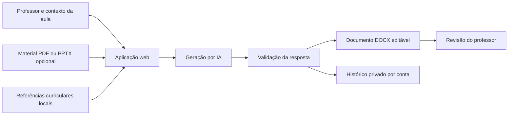
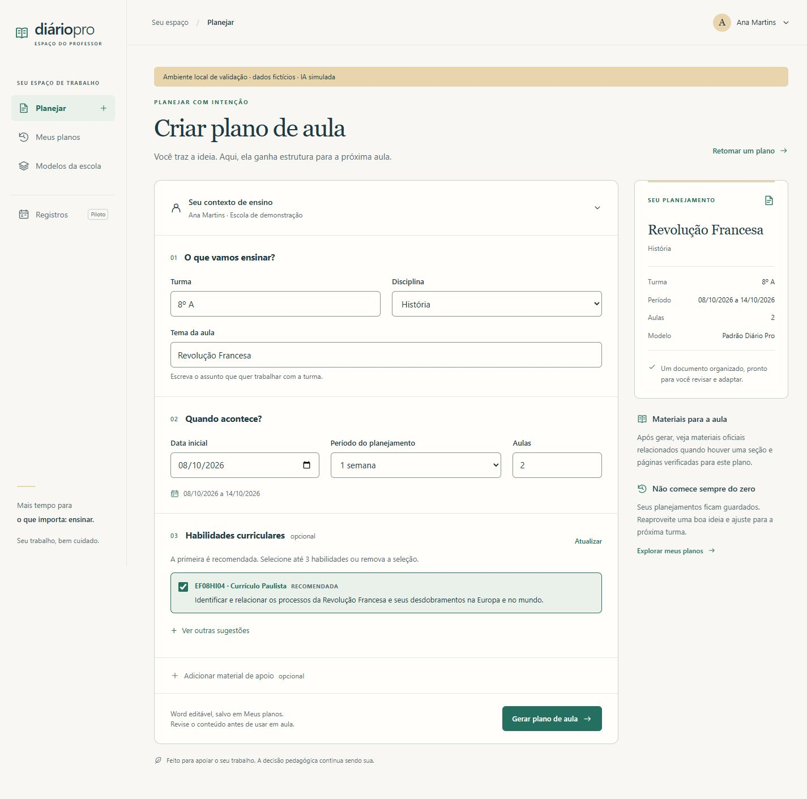
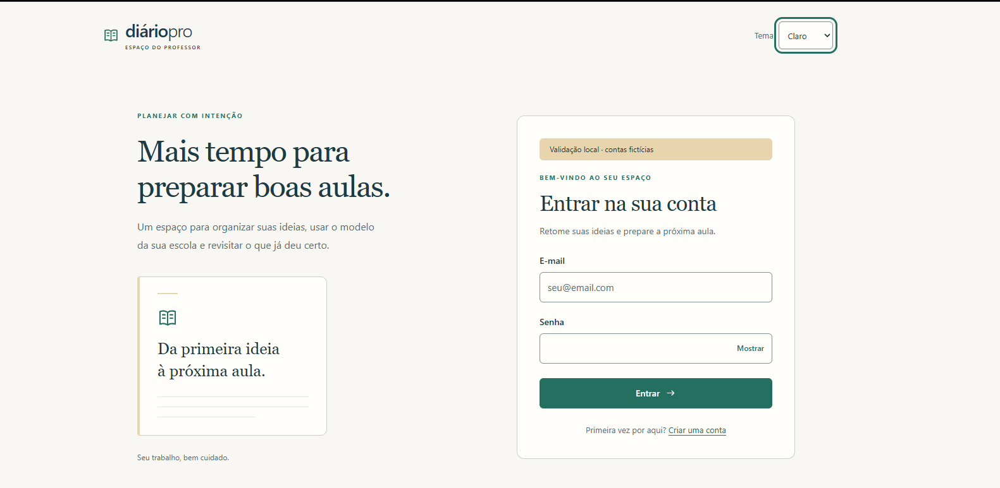

# DiárioPro

**IA aplicada ao planejamento de aulas: do contexto do professor a um documento Word editável.**

Estudo de caso de produto desenvolvido com apoio de agentes de IA. Combina geração de conteúdo, referências curriculares verificáveis e um fluxo completo de uso. Este repositório reúne documentação pública; a implementação e os dados da aplicação permanecem privados.

## O problema

Preparar um plano de aula envolve reunir objetivos, referências curriculares, materiais de apoio e o formato exigido pela escola. Um texto gerado em um chat ainda precisa ser conferido, organizado e transferido para um documento utilizável.

O DiárioPro conecta essas etapas em uma aplicação: o professor informa o contexto, seleciona habilidades curriculares, pode anexar material e recebe um DOCX editável para revisar e adaptar.

## O que está implementado

- Geração de planos a partir de tema, disciplina, turma, período e quantidade de aulas.
- Consulta e seleção de habilidades em uma base curricular local com proveniência.
- Validação estruturada da resposta da IA e controle dos códigos curriculares aceitos.
- Integração com Groq e OpenRouter, com tratamento de falhas e fallback conforme a configuração.
- Extração de texto de materiais PDF e PPTX no fluxo suportado.
- Geração e download de DOCX, histórico e reaproveitamento de planos.
- Importação de modelos escolares DOCX e revisão do mapeamento de campos, preservando o original.
- Contas web, autenticação, isolamento de dados por usuário e preferências de interface.
- Implementações de armazenamento local e em Azure Blob; SQLite no modo local e suporte a PostgreSQL no modo web de produção.

O projeto também possui módulos de diário e entradas assistidas em diferentes estágios de piloto. Eles não são apresentados como integrações escolares plenamente operacionais. O recorte deste portfólio é o fluxo de planejamento.

## Onde a IA entra

O modelo recebe o contexto de planejamento e as referências selecionadas. A resposta é convertida para um contrato estruturado antes de seguir para o documento. Códigos curriculares fora da seleção são rejeitados ou descartados conforme o caso; o modelo não é a fonte oficial desses códigos.

Essa verificação reduz uma classe específica de erro. A qualidade pedagógica do conteúdo continua exigindo revisão do professor. A busca curricular básica é determinística; este caso não depende de um banco vetorial para justificar o uso de IA.

## Arquitetura em alto nível

O diagrama omite credenciais, endereços internos, recursos de infraestrutura e dados escolares.

## Tecnologias confirmadas

| Camada | Tecnologias identificadas na implementação |
|---|---|
| Aplicação | Python, FastAPI, Uvicorn, Jinja2, JavaScript e CSS |
| IA | SDK Groq e cliente compatível com OpenAI para OpenRouter |
| Documentos | docxtpl, python-docx, PyPDF2 e python-pptx |
| Dados | SQLAlchemy, Alembic, SQLite e suporte a PostgreSQL |
| Armazenamento | Implementação local e Azure Blob Storage |
| Validação do desenvolvimento | pytest e verificações de interface com Node.js/Playwright documentadas |

Bibliotecas identificadas no código e nas dependências. A tabela não significa que todos os modos foram executados nesta revisão.

## Evidências e resultados

| Evidência | Resultado | Contexto |
|---|---:|---|
| Base curricular versionada | **1.958 registros** | Contagem direta dos três arquivos de fontes em 28/10/2026: 1.351 + 460 + 147 |
| Seleção de regressões Python | **146 aprovadas, 2 ignoradas** | Relatório de usabilidade V3.2, de 10/10/2026; ambiente isolado |
| Verificações Node.js | **48 aprovadas** | Mesmo marco histórico, para modelos/conta e planejamento |

Os registros curriculares preservam fontes distintas; códigos que aparecem em duas fontes não são necessariamente habilidades únicas. Os testes são resultados históricos documentados e não foram reexecutados para montar este portfólio. Não há medição validada de horas economizadas, usuários ativos ou ganho pedagógico.

Detalhamento: [evidências e limites](docs/evidencias.md).

## Interface

Captura histórica de validação local: dados fictícios e IA simulada, explicitamente sinalizados na própria tela. Demonstra o fluxo visual; não comprova uma chamada real ao provedor ou a aparência da versão atual em produção.

Ver tela de acesso

Captura histórica sem sessão ou credenciais preenchidas.

## Desenvolvimento com agentes de IA

Usei principalmente **Codex e Kiro** no desenvolvimento dos meus projetos, com uso pontual de Gemini/Antigravity. Os registros do DiárioPro mostram uma evolução por marcos: diagnóstico, mudanças delimitadas, regressões e revisão visual.

Um exemplo concreto é a geração curricular: a IA produz o conteúdo, enquanto a aplicação controla quais códigos podem ser aceitos. Outro é o refinamento de interface acompanhado de verificações de isolamento entre contas e recuperação de erros.

Esse relato descreve o uso das ferramentas e o processo registrado. Não atribui a uma ferramenta específica cada arquivo ou decisão, nem estima produtividade sem medição. [Decisões e processo de construção](docs/decisoes-e-ia.md).

## Competências demonstradas para AI Builder

Transformação de uma tarefa de negócio em um fluxo utilizável; integração de IA com dados de referência; saída estruturada; documentos como entrega final; experiência do usuário; validação e cuidado com dados privados.

O estudo de caso não possui vínculo com o iFood. O código-fonte, as bases operacionais e os documentos escolares não são distribuídos neste repositório.
